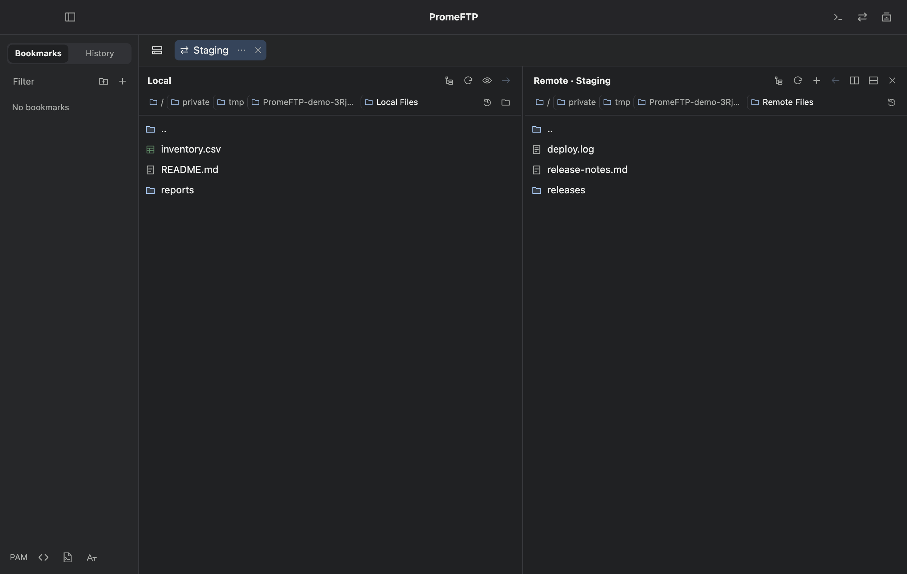

# PromeFTP

MIT 라이선스 기반 오픈 소스 SSH·SFTP 앱입니다. macOS 13 이상에서 사용할 수 있습니다.

[다운로드](https://github.com/PROMLEE/promeftp/releases/latest) · [설치 가이드](docs/INSTALL.ko.md) · [사용 가이드](docs/USAGE.ko.md) · [English](README.md)

## 설치와 첫 실행

1. [공식 GitHub 릴리스](https://github.com/PROMLEE/promeftp/releases/tag/v1.1.0)의 **Assets**에서 `PromeFTP-1.1.0-macos-arm64.dmg`를 받습니다.
2. DMG를 열고 **PromeFTP**를 **Applications** 폴더로 드래그합니다.
3. Finder의 **응용 프로그램**에서 **PromeFTP**를 실행합니다.

### 첫 실행에서 macOS가 차단할 때

이 배포본은 자체 서명으로 배포되며 Apple 공증을 받지 않았습니다. 첫 실행 때 Apple이 PromeFTP에 악성 소프트웨어가 있는지 확인할 수 없다는 경고가 표시될 수 있습니다. 공식 릴리스에서 받은 DMG임을 확인한 뒤 아래 순서로 진행하세요.

1. 경고창에서 **완료**를 누릅니다.
2. ** → 시스템 설정 → 개인정보 보호 및 보안**을 열고 아래쪽 **보안**으로 이동합니다.
3. PromeFTP 실행이 차단되었다는 메시지 옆의 **그래도 열기**를 누릅니다.
4. 확인창에서 앱 이름이 **PromeFTP**인지 확인하고 **열기** 또는 **그래도 열기**를 누릅니다. macOS가 요청하면 Touch ID나 Mac 로그인 암호로 확인합니다.

**그래도 열기**가 보이지 않으면 Finder의 **응용 프로그램**에서 PromeFTP 실행을 다시 시도한 직후 설정을 확인하세요. macOS가 앱이 손상되었거나 컴퓨터를 손상시킨다고 표시하면 실행을 중단하세요. [Apple의 공식 실행 안내](https://support.apple.com/ko-kr/102445)

이 단계는 macOS에서 PromeFTP 실행을 허용하는 절차입니다. SFTP에서 데스크탑·문서·다운로드 같은 로컬 보호 폴더를 열 때는 macOS가 해당 폴더 접근을 따로 물을 수 있습니다.

## 주요 기능

| 기능 | 사용 방법 |
| --- | --- |
| SSH | 탭을 열고 좌우 또는 상하로 분할합니다. ⌘P로 터미널 트리거를 관리합니다. |
| SFTP | 왼쪽 로컬과 오른쪽 원격 사이에 파일을 끌어 놓습니다. 같은 탭에 원격 패널을 추가해 서버 간 복사도 할 수 있습니다. |
| 호스트 | 직접 접속하거나 OpenSSH 별칭을 고릅니다. 별칭과 실제 목적지, 사용자, 포트를 따로 확인합니다. |
| 워크스페이스 | 포함할 탭을 골라 저장합니다. 저장한 레이아웃을 열어도 기존 연결은 유지됩니다. |
| 인증 | 호스트 키 지문을 확인하고 연결별 저장 응답이나 전역 PAM 규칙을 관리합니다. |
| 설정 | ⌘,로 열어 테마, 글꼴, 무제한 스크롤백, 업데이트, 버전을 확인합니다. |
| AI 에이전트 | 클라이언트·북마크별 권한을 부여해 SSH 명령, SFTP 조회, PAM·트리거, 활동 이력을 로컬 CLI에서 사용합니다. |

자세한 조작은 [한국어 사용 가이드](docs/USAGE.ko.md)를 참고하세요. [기능 및 제한](docs/FEATURES.md) · [문제 해결](docs/TROUBLESHOOTING.md) · [1.1.0 릴리스 노트](docs/releases/1.1.0.ko.md)

## 로드맵

예정된 작업은 [TODO.md](TODO.md)에서 확인할 수 있습니다.

## 라이선스

PromeFTP 앱 소스는 이 저장소에서 공개하며 [MIT 라이선스](LICENSE)를 적용합니다. Copyright © 2026 Promlee. MIT 조건에 따라 저작권과 허가 고지를 포함하면 개인·상업적 사용, 수정, 재배포가 가능합니다. 외부 구성요소에는 별도 조건이 적용됩니다. [제3자 라이선스 고지](THIRD-PARTY-NOTICES.md)를 참고하세요.
