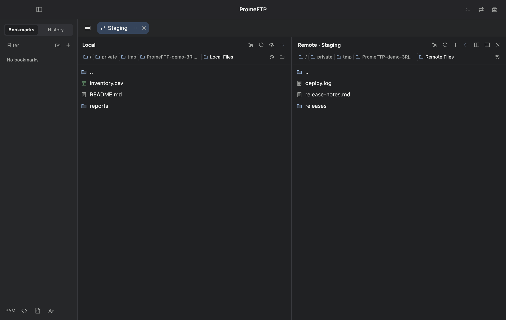

  <h1>PromeFTP</h1>
  
<strong>SSH terminals and SFTP file transfers in one macOS workspace.</strong>

  
<a href="https://github.com/PROMLEE/promeftp/releases/latest">Download for Apple Silicon</a> · <a href="docs/INSTALL.md">Install</a> · <a href="docs/USAGE.md">User guide</a> · <a href="README.ko.md">한국어</a>

  
macOS 13 or later · Apple Silicon · Version 1.0.0

*PromeFTP 1.0.0 connected to a test server with sample files.*

## What you can do

| Task | How PromeFTP handles it |
| --- | --- |
| Work across hosts | Keep SSH sessions in tabs, split right or down, and drag live panes into another layout. |
| Transfer files | Drag from Local to Remote or back. Split the remote area to copy between servers through your Mac. |
| Reuse OpenSSH settings | Search aliases and see the resolved destination, user, and port. Override individual values for a connection. |
| Organize repeat work | Keep bookmarks in folders, reopen recent hosts from History, and save selected tabs and pane layouts as a workspace. |
| Handle interactive login | Verify host fingerprints, respond to keyboard-interactive prompts, and manage encrypted saved answers or global PAM rules. |
| Make the terminal yours | Pick a font, preview it, set scrollback, and open connection-specific snippets with ⌘P. |

## Install and connect

1. Download the **DMG** from [Releases](https://github.com/PROMLEE/promeftp/releases/latest), open it, and drag PromeFTP to **Applications**.
2. Launch the app. If macOS blocks the first launch, verify the download and follow [Open Anyway](docs/INSTALL.md#first-launch-on-macos). The app uses the persistent PromeFTP signing certificate and has no Apple notarization.
3. Press **⌘N**, enter a host, and choose **SSH** or **SFTP**. If you already have an alias in `~/.ssh/config`, use **OpenSSH Config** in the sidebar.

Upgrading from the beta? Use **PromeFTP → Check for Updates…** after closing active connections. The signed update preserves local settings. [Update guide](docs/UPDATES.md)

## Documentation

| Guide | Where to look |
| --- | --- |
| [Install](docs/INSTALL.md) | Verify downloads, install the app, approve first launch, and understand macOS prompts. |
| [Use PromeFTP](docs/USAGE.md) | Connect to a host, transfer files, split terminals, save layouts, and configure PAM and Preferences. |
| [Features and limits](docs/FEATURES.md) | Check transfer behavior, workspace persistence, terminal support, and what requires a new login. |
| [Troubleshooting](docs/TROUBLESHOOTING.md) | Diagnose config, login, upload, font, and update issues. |
| [Privacy and security](SECURITY.md) | See what is stored locally, when the app contacts a service, and how to report a problem. |
| [Release notes](docs/releases/1.0.0.md) | Review the 1.0.0 changes and beta upgrade path. |
| [Documentation index](llm.txt) | Find canonical plain-text and Markdown sources for assistants. |

## Keyboard shortcuts

| Keys | Action |
| --- | --- |
| ⌘N / ⌘T | New host / local login shell |
| ⌘D / ⌘⇧D | Split terminal right / down |
| ⌘P / ⌘F | Open snippets / find terminal output |
| ⌘K | Clear the buffer and keep the cursor line |
| ⌘, | Open Preferences |

See **Preferences → General → Keyboard Shortcuts** for the complete list. Report ordinary bugs through [GitHub Issues](https://github.com/PROMLEE/promeftp/issues).
