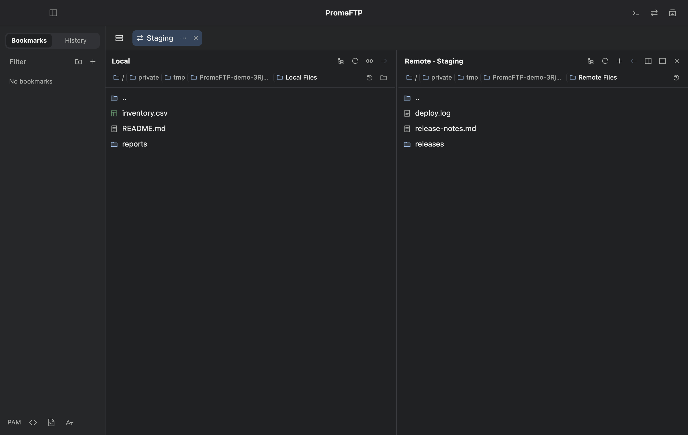

# PromeFTP user guide

[Install](INSTALL.md) · [Features and limits](FEATURES.md) · [Troubleshooting](TROUBLESHOOTING.md)

## Start with one host

1. Press **⌘N** and set a hostname, username, and port if your server uses a nondefault port.
2. Choose **SSH** to open a terminal. Choose **SFTP** to open a local and a remote browser.
3. Use the bookmark button if you will return to this host. An authenticated connection also appears in **History**.

## Connect and organize hosts

Choose a bookmark or use **+** to create a connection. Set a display name, hostname or IP, and optional user, port, or identity file. Choose **SSH** or **SFTP**. The bookmark button saves the connection. Use the sidebar’s **Bookmarks** tab to create folders, drag bookmarks into folders, or open, move, and delete them from the context menu. **History** records successful connections and keeps the latest entry per alias within each config file.

Open **OpenSSH Config** from the sidebar or Preferences. Search aliases, move with the arrow keys, and press Return. You can register other config files, open them in your text editor, or remove them from the list. Alias and destination appear separately. Explicit hostname, user, and port overrides are optional. Clear an override to use the OpenSSH value again. PromeFTP follows OpenSSH’s settings for keys, known hosts, jump hosts, and proxy commands. The app disables port forwarding.

When a gateway login contains multiple `@` characters, **Split address** separates the destination at the last `@` and preserves the rest as the username. Use the format your gateway administrator provides.

## SSH and terminal settings

Use **⌘T** for a local login shell. Remote SSH uses the account’s shell and server-side configuration. A Zsh account loads its own Oh My Zsh configuration when installed and configured. Install a compatible font on your Mac to render its prompt glyphs.

Open **Preferences → Terminal** to choose an installed fixed-width font or enter a font family, preview it, set size, and configure Option as Meta. Scrollback defaults to 20,000 lines. **Unlimited scrollback** keeps output in memory for the current session without a configured line limit. Long sessions can use substantial memory, and xterm.js imposes its own buffer ceiling. Enabling it cannot restore already discarded output. **Clear Buffer** keeps the current cursor line. Use **⌘F** to search output and **⌘+**, **⌘−**, or **⌘0** to change text size.

**⌘P** opens Snippets. Save a command for all terminals or **This connection**, then search and press Return to paste it. Review the command in the terminal before running it. **Preferences → Shortcuts** lists the available bindings.

## SFTP

The left panel opens your local home directory. The remote panel opens the server’s initial directory after authentication. Click a breadcrumb or the blank part of the path bar to navigate. Use the clock for recent paths, the tree button for folder navigation, and **..** for the parent folder. Shift selects a range and ⌘ adds or removes individual selections.

Drag a selection to another panel or use the transfer arrows. Split the remote area to open more remote connections with one shared local browser. Drag between remote panels in the same tab to copy through a temporary directory on your Mac. The source stays in place. File operations reuse the authenticated SFTP connection. A new connection or reconnect can require authentication again.

When uploading to an existing remote file, choose **Skip** or **Replace**. Replacement happens after the new file has transferred. The server may reject the replacement. Existing folders and download targets are protected from overwrite. The connection status displays transfer progress and errors.

## Tabs, splits, and workspaces

Use the tab menu to name, color, or group a tab. Return saves an edited name and Escape cancels. Drag tabs to reorder or group them. Drop a terminal on an edge to split it. Use the pane handle to move a live pane, or use **⌘D** and **⌘⇧D** to open a new connection to the right or below. The split picker starts with **New Connection**, followed by searchable saved hosts and aliases.

Choose **Workspaces** and select the tabs to include before saving. A workspace stores tab names, groups, colors, order, pane sizes and directions, connection settings, and SFTP paths. **Open Tabs** appends the saved layout while your current connections continue running. Restored connections authenticate again. Terminal output and running processes are outside the saved layout. To replace a saved layout, delete it and save a new one.

## Host keys and PAM

When OpenSSH requests host verification, compare the displayed fingerprint with one supplied by your administrator before trusting it. **Don’t ask again for this verified key** remembers the verified address, port, and fingerprint. A different key requires its own verification.

OpenSSH keyboard-interactive authentication can show password, OTP, or other PAM questions. Respond when the input appears. **Save answer** stores a reusable response after successful authentication. Its checkbox remembers your last choice. In **Preferences → Authentication**, manage saved answers, control whether they send automatically, or move an answer to **Global PAM Rules**. Turn off **Send saved answers automatically** if you want to review a filled response before sending.

Global rules use exact questions or RE2 regular expressions. For example, `^Password:$` matches that whole prompt, and `\n` matches a line break inside a question. Rules send a fixed reply once per matching question per connection. Connection-specific rules and saved replies take priority. Use global rules only for answers appropriate across the hosts you connect to. Leave one-time codes unsaved. **Authentication Activity** shows the question, time, and rule source for automatic replies.

## Preferences and About

Open **PromeFTP → Preferences…** or press **⌘,**. General contains language, appearance, SSH config, and updates. Terminal contains font and buffer options. Authentication manages PAM answers and Shortcuts lists key bindings. About displays the running version and build with links to the guide, release notes, and issue tracker.

Use **Preferences → General → Language** to select English, Korean, Japanese, Simplified Chinese, or the macOS language. Click **Save** to apply the language while your connections stay open. Server output and prompts remain in their original language.
