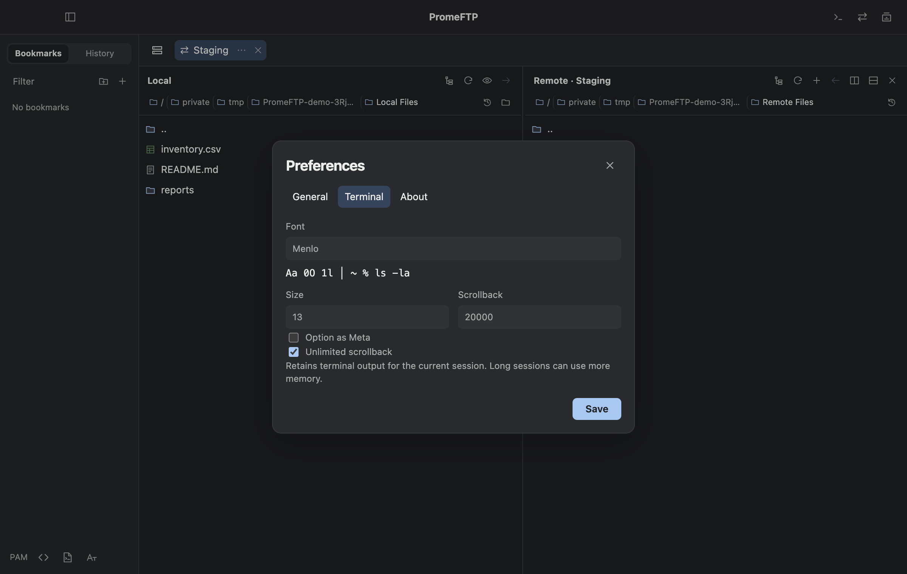

# PromeFTP 1.0.0

The first stable release for Apple Silicon Macs running macOS 13 or later.

## What’s new since 0.0.9

| Change | Where to find it |
| --- | --- |
| One Preferences window for appearance, SSH config, PAM, shortcuts, and updates | **⌘, → General** |
| Installed fixed-width fonts, a custom font family, and live preview | **⌘, → Terminal → Font** |
| Optional unlimited session scrollback with the existing finite setting still available | **⌘, → Terminal → Unlimited scrollback** |
| Running version, build, and links to support and documentation | **⌘, → About** |

This release includes the beta’s split SSH terminals, dual-pane SFTP and same-tab remote copying, OpenSSH alias overrides, bookmarks and history, selected-tab workspaces, connection-specific snippets, and keyboard-interactive authentication.

## Install or upgrade

- New installation: download the Apple Silicon DMG and drag PromeFTP into Applications. Use the matching SHA-256 file to verify the download.
- From 0.0.9: close active sessions and select **PromeFTP → Check for Updates…**. Existing local settings remain available.
- The 1.0.0 app uses the stable feed and the existing PromeFTP signing identity. Apple notarization is not included. If macOS blocks first launch, follow the steps in the install guide.

Unlimited scrollback uses memory for the life of the session. Workspace restore opens new connections alongside your current tabs.

[Installation guide](https://github.com/PROMLEE/promeftp/blob/main/docs/INSTALL.md) · [User guide](https://github.com/PROMLEE/promeftp/blob/main/docs/USAGE.md) · [Features and limits](https://github.com/PROMLEE/promeftp/blob/main/docs/FEATURES.md)
